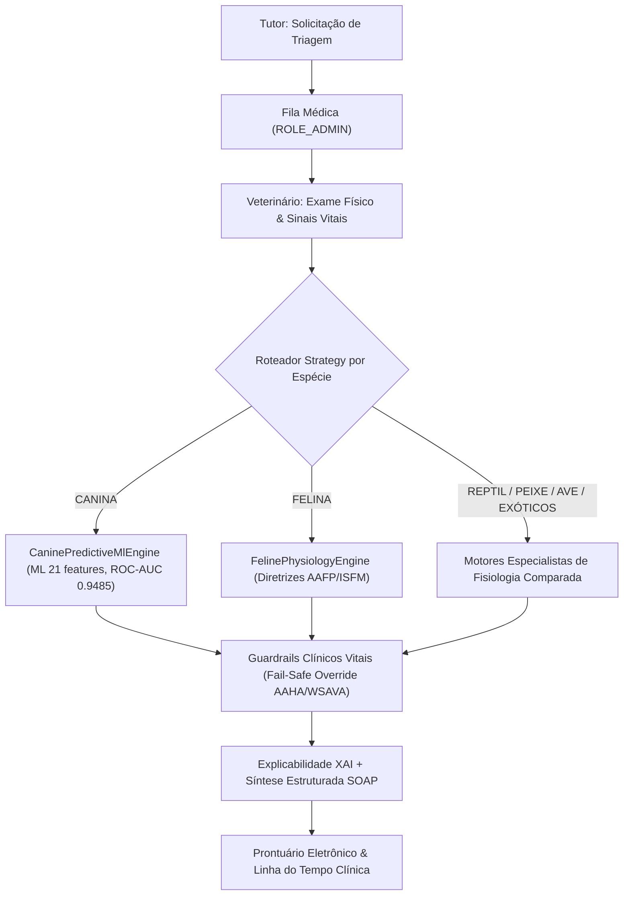
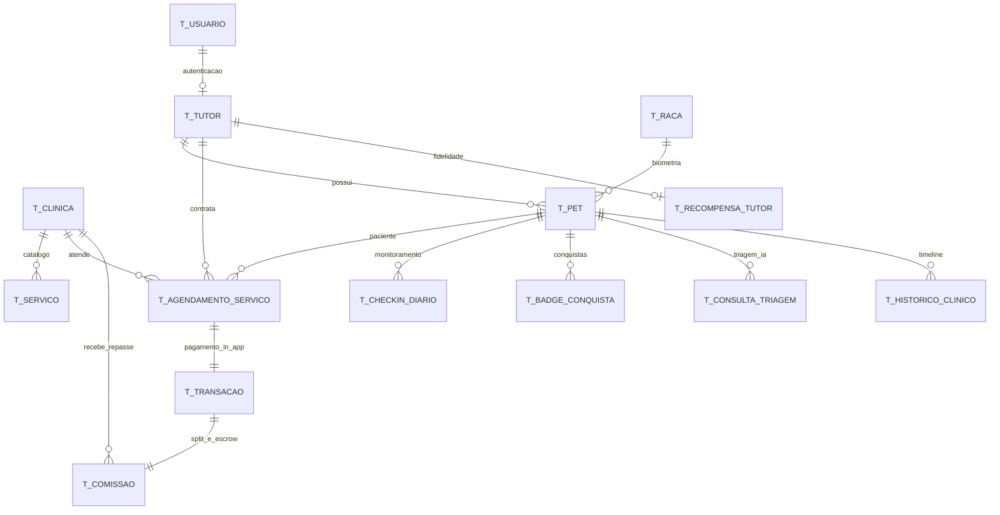

<div align="center">

# 🐾 Clyvo Vet Web v2 — Entrega Final (4ª Sprint Java Advanced FIAP)
### **Plataforma HealthTech & Marketplace B2B2C de Medicina Veterinária Preventiva, Longevidade Pet e Suporte à Decisão Clínica (CDSS)**

[](https://www.oracle.com/java/)
[](https://spring.io/projects/spring-boot)
[](https://spring.io/projects/spring-security)
[-CC0200?style=for-the-badge&logo=flyway&logoColor=white)](https://flywaydb.org/)
[](#-testes-automatizados-113-testes--e2e-playwright)
[-FF0000?style=for-the-badge&logo=youtube&logoColor=white)](https://youtu.be/Z_FFclzDsFU)

<p align="center">
  <a href="#-narrativa-da-solução--proposta-de-valor">Narrativa</a> •
  <a href="#-integração-multidisciplinar-fiap-4ª-sprint">Integração Multidisciplinar</a> •
  <a href="#-como-executar-localmente">Como Executar</a> •
  <a href="#-deploy-online-docker--render">Deploy Online</a> •
  <a href="#-arquitetura--decisões-de-design">Arquitetura</a> •
  <a href="#-fluxos-principais-do-sistema">Fluxos</a> •
  <a href="#-testes-automatizados-113-testes--e2e-playwright">Testes</a> •
  <a href="https://youtu.be/Z_FFclzDsFU"><b>🎥 Vídeo YouTube</b></a> •
  <a href="docs/ROTEIRO_GRAVACAO_VIDEO.md"><b>🎬 Roteiro do Vídeo (15 min)</b></a>
</p>

</div>

---

## 📦 Artefatos Oficiais da Entrega Final (4ª Sprint FIAP)

| Requisito da Rubrica FIAP | Pontuação | Evidência / Documento no Repositório |
| :--- | :---: | :--- |
| **1. Demonstração Técnica da Solução** (Deploy, fluxos completos, Java 21 / Spring Boot 3.3.4, UI/UX) | **40 pts** | Aplicação Web Completa + [`Dockerfile`](Dockerfile) + [`render.yaml`](render.yaml) |
| **2. Narrativa da Solução** (Proposta de valor, decisões de design, escolhas tecnológicas e originalidade) | **20 pts** | Seção [Narrativa da Solução](#-narrativa-da-solução--proposta-de-valor) + [`docs/DOSSIE_TECNICO_AVALIACAO_CRITICA.md`](docs/DOSSIE_TECNICO_AVALIACAO_CRITICA.md) |
| **3. Integração Multidisciplinar** (Conexão com as demais disciplinas + scripts SQL, protótipos e evidências) | **20 pts** | [`docs/INTEGRACAO_MULTIDISCIPLINAR_SPRINT4.md`](docs/INTEGRACAO_MULTIDISCIPLINAR_SPRINT4.md) + [`docs/sql/SCHEMA_E_SEED_CONSOLIDADO_SPRINT4.sql`](docs/sql/SCHEMA_E_SEED_CONSOLIDADO_SPRINT4.sql) |
| **4. Apresentação Oral e Comunicação em Equipe** (Roteiro estruturado para todos os integrantes em até 15 min) | **10 pts** | 🎥 **[Assistir Vídeo da Apresentação no YouTube](https://youtu.be/Z_FFclzDsFU)** <br> [`docs/ROTEIRO_GRAVACAO_VIDEO.md`](docs/ROTEIRO_GRAVACAO_VIDEO.md) + [`docs/GUIA_AVALIACAO_ORAL.md`](docs/GUIA_AVALIACAO_ORAL.md) |
| **5. Organização da Entrega e Documentação** (Repositório estruturado, README completo e instruções claras) | **10 pts** | Este `README.md` + [`docs/PESQUISA_DE_MERCADO_CLYVO_VET.md`](docs/PESQUISA_DE_MERCADO_CLYVO_VET.md) |

---

## 💡 Narrativa da Solução & Proposta de Valor

### O Problema Real
No mercado veterinário brasileiro, a assistência clínica ainda é predominantemente **reativa e episódica**: mais de 70% dos tutores procuram atendimento apenas quando o animal já apresenta sintomas agudos, o que eleva drasticamente os custos hospitalares e reduz a longevidade do pet. Paralelamente, marketplaces veterinários tradicionais sofrem com a **desintermediação (fuga de transação no balcão)**: o tutor agenda pela plataforma, mas paga diretamente na clínica sem retenção nem histórico integrado.

### Nossa Proposta e Originalidade
O **Clyvo Vet Web v2** resolve ambos os problemas ao integrar três motores em uma única arquitetura:
1. **Gamificação de Saúde Preventiva (`Clyvo Longevity Rewards`):** O tutor realiza **check-ins diários** de alimentação, humor, atividade física e medicação. A constância gera *streaks*, desbloqueia *badges* e converte *Clyvo Coins* em **descontos progressivos reais (5% a 20% OFF)** na rede credenciada, além de disparar alertas automáticos ao corpo clínico quando detecta apatia ou sintomas precoces.
2. **Suporte à Decisão Clínica Multi-Espécie (`Dual-Engine CDSS`):** Na triagem veterinária, o sistema combina **Guardrails Clínicos Determinísticos** (diretrizes AAHA/WSAVA como *fail-safe* vital) com **Machine Learning Supervisionado (`CanineWellness-ML-v1.0`, ROC-AUC 0.9485)** e **Sistemas Especialistas de Fisiologia Comparada** para **9 classes biológicas** (cães, gatos, répteis ectotérmicos, peixes, aves, roedores, mustelídeos, aracnídeos e equinos), gerando explicabilidade XAI e síntese clínica no padrão **SOAP**.
3. **Marketplace B2B2C com Split Paritário e Custódia Escrow:** O tutor contrata vacinas e check-ups diretamente in-app (via **PIX QR Code Dinâmico** ou **Stripe Checkout**). O algoritmo `SplitFinanceiroCalculator` aplica **co-financiamento paritário do desconto** com proteção de piso de repasse de **75% (*Floor Protection*)** para a clínica parceira e retém os valores em **custódia Escrow** até que o **Voucher Digital (`CLYVO-...`)** seja validado presencialmente na recepção.

---

## 🔗 Integração Multidisciplinar (FIAP 4ª Sprint)

A documentação completa com diagramas e links diretos para os artefatos encontra-se em **[`docs/INTEGRACAO_MULTIDISCIPLINAR_SPRINT4.md`](docs/INTEGRACAO_MULTIDISCIPLINAR_SPRINT4.md)**:

- **☕ Java Advanced:** Arquitetura em camadas com Spring Boot 3.3.4, Java 21, Spring Security 6 (Form Login BCrypt + Google OAuth2/OIDC + RBAC + proteção Anti-IDOR), Bean Validation, Strategy Pattern para motores clínicos e gateways de pagamento, e tratamento global de exceções (`@ControllerAdvice`).
- **🗄️ Mastering Relational and Non-Relational Database:** Modelagem relacional em **3ª Forma Normal (15 tabelas)** gerida integralmente por **15 migrações Flyway (`V1` a `V15`)** com `ddl-auto=none`. Script consolidado com DDL e queries analíticas em [`docs/sql/SCHEMA_E_SEED_CONSOLIDADO_SPRINT4.sql`](docs/sql/SCHEMA_E_SEED_CONSOLIDADO_SPRINT4.sql).
- **🧠 Disruptive Architectures (IA & ML):** Motor logístico multivariado de 21 features calibrado em 10.000 amostras clínicas (`CanineWellness-ML-v1.0`), explicabilidade XAI e motores de fisiologia comparada multi-espécie.
- **☁️ DevOps Tools & Cloud Computing:** Build containerizado multi-stage em [`Dockerfile`](Dockerfile) (Eclipse Temurin JDK/JRE 21 Alpine), blueprint IaC em [`render.yaml`](render.yaml) com PostgreSQL gerenciado e segregação de perfis `dev` / `prod`.
- **🎨 UX/UI Design & Front-End:** Design System clínico autoral (*Ficha Clínica*) em [`clyvo.css`](src/main/resources/static/css/clyvo.css), tipografia `Bricolage Grotesque` + `IBM Plex Sans` com `tabular-nums`, fragmentos Thymeleaf reutilizáveis sem repetição (DRY) e acessibilidade WCAG/ARIA.
- **🛡️ Compliance & Quality Assurance:** **113 testes automatizados** (JUnit 5 + MockMvc + Spring Security Test) e auditoria E2E no navegador com **Playwright**.

---

## 🚀 Como Executar Localmente

### Pré-requisitos
| Ferramenta | Versão |
| :--- | :--- |
| **JDK** | 21 |
| **Maven** | 3.8+ |

O banco H2 em memória e as 15 migrações do Flyway sobem automaticamente sem necessidade de configuração externa.

### Passo a passo
```bash
git clone https://github.com/Gabriel-Maciel06/clyvo-vet-web-v2.git
cd clyvo-vet-web-v2

mvn clean test        # Executa os 113 testes automatizados (100% verdes)
mvn spring-boot:run   # Inicia a aplicação em http://localhost:8095
```

> Caso possua múltiplos JDKs instalados no macOS:
> `export JAVA_HOME=$(/usr/libexec/java_home -v 21)`

### Credenciais de Acesso (Seed Inicial)
| Perfil | Usuário | Senha | Permissões Principais |
| :--- | :--- | :--- | :--- |
| **Tutor (`ROLE_TUTOR`)** | `tutor` | `tutor123` | Dashboard Tutor, Meus Pets, Check-in Diário, Clyvo Rewards, Solicitar Triagem, Marketplace In-App, Pagamento PIX e Vouchers |
| **Veterinário (`ROLE_ADMIN`)** | `admin` | `admin123` | Central Médica, Alertas Clínicos, Fila de Triagem IA, Avaliação Clínica Dual-Engine e Validação/Baixa de Vouchers na Clínica |

---

## ☁️ Deploy Online (Docker & Render)

A aplicação é empacotada em contêiner Docker multi-stage e utiliza **PostgreSQL** em produção (`SPRING_PROFILES_ACTIVE=prod`). As mesmas 15 migrações Flyway rodam no H2 local e no PostgreSQL em nuvem.

### Variáveis de Ambiente de Produção

| Variável | Obrigatória | Padrão | Finalidade |
| :--- | :--- | :--- | :--- |
| `SPRING_PROFILES_ACTIVE` | Sim | — | Definir como `prod` em produção |
| `DB_USER` / `DB_PASSWORD` | Sim | — | Credenciais do banco PostgreSQL |
| `DB_URL` | Ver nota | — | URL JDBC ou `postgres://` (normalizada por `DataSourceUrlNormalizerConfig`) |
| `DB_HOST` / `DB_PORT` / `DB_NAME` | Ver nota | `localhost` / `5432` / `clyvodb` | Alternativa modular a `DB_URL` |
| `APP_URL_BASE` | Não | `http://localhost:8095` | URL pública base para callbacks OAuth2, Stripe e links de e-mail |
| `PORT` | Não | `8095` | Porta HTTP injetada pelo provedor de nuvem |

### Executar com Docker
```bash
docker build -t clyvo-vet-web-v2 .

docker run -p 8095:8095 \
  -e SPRING_PROFILES_ACTIVE=prod \
  -e DB_HOST=seu-host -e DB_NAME=clyvodb \
  -e DB_USER=clyvo -e DB_PASSWORD=sua-senha \
  clyvo-vet-web-v2
```

### Deploy Automatizado no Render (`render.yaml`)
O arquivo [`render.yaml`](render.yaml) na raiz configura o Blueprint completo (serviço web Docker + banco PostgreSQL `clyvo-db`) pronto para deploy contínuo.

---

## 🏛️ Arquitetura & Decisões de Design

### 1. Segurança Híbrida (`SecurityConfig`)
- **Login Local + Recuperação de Senha:** Autenticação via `DaoAuthenticationProvider` com senhas em `BCryptPasswordEncoder`. Recuperação de senha via token único de 30 minutos (`T_TOKEN_RECUPERACAO_SENHA`) sem enumeração de usuários.
- **Login Social com Google OAuth2 / OIDC:** Provisionamento automático em `CustomOAuth2UserService` e `CustomOidcUserService`. Novos usuários recebem CPF provisório e são guiados ao fluxo `/perfil/completar-cadastro`. No ambiente local sem chaves de API do Google Cloud, o sistema disponibiliza um **Modo Demo OAuth2 (`/login/google-demo`)** para avaliação completa do fluxo.
- **Proteção RBAC e Anti-IDOR:** Segregação estrita entre `ROLE_TUTOR` e `ROLE_ADMIN` na `SecurityFilterChain`, em `@PreAuthorize` e na camada de domínio (`PetService.buscarPorIdAutorizado` e `CheckoutController.buscarAgendamentoAutorizado`), impedindo que um tutor acesse pets, pagamentos ou vouchers de terceiros.

### 2. Arquitetura Dual-Engine CDSS (Padrão Strategy)


### 3. Modelagem Relacional 3FN do Marketplace e Split Bipartite


---

## 🔄 Fluxos Principais do Sistema

1. **Fluxo 1 — Gestão Biométrica Multi-Espécie e Protocolo de Longevidade (`/pets`, `/pets/novo`, `/pets/{id}`):**
   - Catálogo com **9 classes biológicas** (Canina, Felina, Réptil, Peixe, Ave, Roedor, Mustelídeo, Aracnídeo e Equina), recomendação dinâmica de faixa de peso saudável, cálculo de idade humana equivalente e calendário vacinal/preventivo automatizado.
2. **Fluxo 2 — Check-in Diário Gamificado e Alertas Precoces (`/checkin/novo`, `/checkin/recompensas`):**
   - Registro diário de hábitos (+10 coins base, +5 exercício $\ge 30$ min, +5 medicação), progressão automática de nível (**Bronze 5%**, **Prata 10%**, **Ouro 15%**, **Diamante 20%**) e geração imediata de alerta clínico na central médica caso haja sintomas ou apatia.
3. **Fluxo 3 — Marketplace Preventivo, Split com Subsídio Paritário e PIX Sandbox (`/servicos`, `/servicos/checkout`, `/servicos/pagamento/{id}`, `/servicos/voucher/{id}`):**
   - Contratação in-app com desconto de fidelidade, cálculo transparente de repasse protegido (piso 75%) e comissão Clyvo, geração de QR Code PIX dinâmico com polling em tempo real, simulação de liquidação em sandbox e emissão de Voucher Digital (`CLYVO-...`).
4. **Fluxo 4 — Fila Médica, Avaliação Preditiva Dual-Engine e Liquidação de Escrow (`/triagem/fila`, `/triagem/avaliar/{id}`, `/servicos/validar-voucher`):**
   - Baixa presencial do Voucher Digital pelo veterinário (liberando o repasse do Escrow) e exame clínico assistido por IA com cálculo de Escore de Longevidade (0–100), $P(\text{Higidez})$ e registro SOAP na linha do tempo do paciente.

---

## 🧪 Testes Automatizados (113 Testes + E2E Playwright)

```bash
mvn clean test   # 113 testes automatizados em 23 classes de teste (0 falhas, 0 erros)
```

| Suíte de Teste | Cobertura Técnica |
| :--- | :--- |
| `ControleDeAcessoPorPerfilTest` / `DashboardTutorSemPerfilTest` | RBAC completo (`ROLE_TUTOR` vs `ROLE_ADMIN`), proteção CSRF, login BCrypt e redirecionamentos seguros. |
| `CadastroERecuperacaoSenhaTest` / `RecuperacaoSenhaServiceTest` | Autocadastro transacional, validação de duplicidade e ciclo completo de token de recuperação de senha. |
| `CustomOAuth2UserServiceTest` / `PerfilServiceTest` | Provisionamento social via Google OAuth2, vínculo de conta por e-mail e conclusão de cadastro (CPF provisório $\rightarrow$ real). |
| `CheckinServiceTest` | Pontuação gamificada, evolução de streak/nível (Prata $\rightarrow$ Ouro), disparo de alertas clínicos e bloqueio de duplicidade diária. |
| `TriagemServiceTest` / `PredictiveMlEngineTest` / `LongevidadeCalculadoraMultiEspecieTest` | Motor Dual-Engine CDSS, Guardrails AAHA/WSAVA, inferência ML canina e motores fisiológicos para ectotérmicos, aves, felinos e exóticos. |
| `PetBiometriaValidacaoTest` / `PetServiceEditTest` | Limites biométricos por espécie/raça, atualização isolada de peso com registro em prontuário e exclusão em cascata. |
| `CheckoutControllerTest` / `PagamentoSplitServiceTest` / `CoFinanciamentoParitarioTest` / `CheckoutLedgerIntegracaoTest` | Fluxo completo de checkout, proteção **Anti-IDOR** no polling de status, cálculo de subsídio paritário com Floor Protection (75%) e custódia Escrow. |
| `StripeGatewayServiceTest` / `StripeWebhookControllerTest` / `RetornoStripeSegurancaTest` / `GatewayPagamentoIntegracaoTest` | Integração Stripe Checkout, validação criptográfica HMAC-SHA256 de webhooks e prevenção de confirmação forjada por URL. |

---

## 📁 Estrutura do Repositório
```text
clyvo-vet-web-v2/
├── Dockerfile                                    # Build multi-stage (Maven JDK 21 -> JRE 21 Alpine)
├── render.yaml                                   # Blueprint IaC (Web Service + PostgreSQL no Render)
├── docs/
│   ├── ROTEIRO_GRAVACAO_VIDEO.md                 # Roteiro de até 15 min dividido para toda a equipe (4ª Sprint)
│   ├── INTEGRACAO_MULTIDISCIPLINAR_SPRINT4.md    # Matriz de integração com as demais disciplinas FIAP
│   ├── DOSSIE_TECNICO_AVALIACAO_CRITICA.md       # Dossiê arquitetural, ML e engenharia financeira
│   ├── GUIA_AVALIACAO_ORAL.md                    # Perguntas e respostas técnicas para a banca
│   ├── PESQUISA_DE_MERCADO_CLYVO_VET.md          # Fundamentação mercadológica e unit economics
│   └── sql/
│       └── SCHEMA_E_SEED_CONSOLIDADO_SPRINT4.sql # DDL 3FN (15 tabelas) + Consultas Analíticas SQL
├── src/main/java/com/fiap/clyvovet/
│   ├── config/                                   # SecurityConfig, GoogleOAuth2Config, DataSourceUrlNormalizerConfig
│   ├── controller/                               # Auth, Home, Pet, Checkin, Triagem, Checkout, Webhook, Perfil
│   ├── dto/                                      # DTOs com Bean Validation e Records de Explicabilidade/ML
│   ├── exception/                                # GlobalExceptionHandler (@ControllerAdvice)
│   ├── gateway/                                  # Strategy de Pagamentos (Stripe, MercadoPago, Simulado)
│   ├── model/                                    # 15 Entidades JPA mapeadas em 3FN
│   ├── repository/                               # 16 Interfaces Spring Data JPA
│   └── service/                                  # Regras de negócio, SplitFinanceiroCalculator e 10 Motores CDSS
├── src/main/resources/
│   ├── application.properties                    # Perfil dev (H2 em memória + Flyway)
│   ├── application-prod.properties               # Perfil prod (PostgreSQL + Segurança estrita)
│   ├── db/migration/V1..V15__*.sql               # 15 Migrações evolutivas Flyway
│   ├── static/css/clyvo.css                      # Design System Clínico ("Ficha Clínica")
│   └── templates/                                # 21 Views Thymeleaf modulares e responsivas
└── src/test/java/com/fiap/clyvovet/              # 23 Classes de Teste (113 Testes Automatizados)
```

---

<div align="center">
  <sub>Desenvolvido para a <b>Entrega Final da 4ª Sprint de Java Advanced — FIAP (2026)</b>.</sub>
</div>
